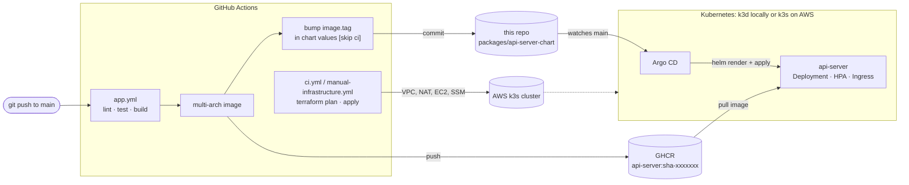

# RS School DevOps Course Tasks

An Nx monorepo that takes a small Express app from commit to a running Kubernetes deployment:
**GitHub Actions** builds and publishes the image (CI), **Argo CD** keeps the cluster in sync with this repository (CD, GitOps), and **Terraform** provisions a k3s cluster on AWS. The same GitOps setup runs on a local **k3d** cluster, so the whole flow can be demonstrated without an AWS account.

## 🏗️ Architecture



| Package | Nx project | What it is |
| --- | --- | --- |
| [`packages/api-server`](packages/api-server) | `api-server` | Express app: HTML page, `/api/health`, `/api/uptime`, `/api/load-test` (CPU load for HPA), opt-in OpenTelemetry |
| [`packages/api-server-chart`](packages/api-server-chart/README.md) | `api-server-chart` | Helm chart for the app; CI rewrites `image.tag` |
| [`packages/argocd`](packages/argocd/README.md) | `argocd` | Argo CD install (Helm), the `api-server` Application, k3d cluster scripts |
| [`packages/setup`](packages/setup/README.md) | `setup` | Terraform: S3 bucket for remote state, GitHub OIDC |
| [`packages/cluster`](packages/cluster/README.md) | `cluster` | Terraform: k3s cluster on AWS (private subnets, NAT instance, SSM access) |
| [`packages/local`](packages/local/README.md) | `local` | Scripts: AWS/GitHub secrets setup, kubectl over an SSM tunnel |

Terraform targets are inferred by the [nx-terraform](https://www.npmjs.com/package/nx-terraform) plugin ([docs](https://alexpialetski.github.io/nx-terraform/)); run `npx nx graph` to see how projects depend on each other.

## ⚡ Local GitOps demo (no AWS)

Requires Docker, [k3d](https://k3d.io), `kubectl`, `helm`, Node.js 22.

```bash
npm ci
npx nx run argocd:cluster-up     # k3d cluster "rsschool", ingress on localhost:8080
npx nx run argocd:bootstrap      # Argo CD + api-server Application, waits for Synced/Healthy
open http://localhost:8080       # the app
npx nx run argocd:ui             # Argo CD UI on localhost:8081 (prints admin password)
npx nx run argocd:cluster-down
```

Argo CD pulls the chart from `main` on GitHub and the image from GHCR, so a merged change reaches the cluster with no manual step. One-time GitHub setup for that is described in the [App Pipeline](.github/workflows/README.md#-app-pipeline-appyml) section (workflow write permissions, public GHCR package).

App development without Kubernetes:

```bash
npx nx serve api-server                        # http://localhost:3333
npx nx run-many -t lint test -p api-server api-server-chart argocd
```

## ☁️ AWS deployment


### Prerequisites

- AWS CLI configured with appropriate credentials
- Node.js (v22+) and npm
- Terraform (v1.8+)
- GitHub CLI (`gh`) for secrets management

### Dev Environment Setup

#### Option 1: Quick Setup (Recommended for New Accounts)

1. **Create AWS Credentials File**
   Create a `.keys` file in the root directory:

   ```bash
   # .keys file content
   AWS_ACCESS_KEY_ID=your-access-key-id
   AWS_SECRET_ACCESS_KEY=your-secret-access-key
   ```

2. **Run Automated Setup**

   ```bash
   # Install dependencies
   npm install

   # Configure AWS CLI and environment
   npx nx run local:configure_env_file
   npx nx run local:configure_github_secrets
   ```

3. **Deploy Infrastructure**

   ```bash
   # Source environment variables
   source .env

   # Deploy backend and cluster
   npx nx run setup:terraform-apply
   npx nx run cluster:terraform-apply

   # Install Argo CD on the cluster (opens the SSM tunnel first)
   npx nx run argocd:bootstrap-aws
   ```

   Terraform targets (`terraform-init`, `-plan`, `-apply`, `-destroy`, `-validate`, `-fmt`, `-output`) are inferred by the [nx-terraform](https://www.npmjs.com/package/nx-terraform) ([docs](https://alexpialetski.github.io/nx-terraform/)) Nx plugin from the `nx-terraform` metadata in each Terraform project's `project.json`. Use `--configuration=dev|stable` on `cluster` plan/destroy to pick the tfvars file, and run `npx nx sync` after changing Terraform providers/modules to refresh the plugin metadata.

#### Option 2: Manual Setup (Traditional Method)

1. **AWS Credentials**

   ```bash
   aws configure
   ```

2. **Environment Variables**
   Create a `.env` file in the root directory:

   ```bash
   TF_VAR_region=us-east-1
   TF_VAR_account_id=012345678901
   TF_WORKSPACE=dev
   ```

3. **GitHub Secrets**
   Manually set up GitHub repository secrets:
   - `AWS_ACCESS_KEY_ID`
   - `AWS_SECRET_ACCESS_KEY`

#### Option 3: Account Change/Reset

When switching to a new AWS account or resetting credentials:

1. **Update Credentials**

   ```bash
   # Update .keys file with new credentials
   vim .keys
   ```

2. **Reconfigure Environment**
   ```bash
   # Reconfigure everything
   npx nx run local:configure_env_file
   npx nx run local:configure_github_secrets
   ```

## 📌 Project status

- **AWS / Terraform**: deployed and exercised in 2025 on temporary KodeKloud playground accounts. Both Terraform projects pass `terraform validate`; plan/apply need an AWS account.
- **App, chart, CI, Argo CD**: built, unit-tested, `helm lint`-ed and statically validated; the end-to-end GitOps loop is meant to be run with the local k3d demo above.

## 📚 Documentation

- [Argo CD README](packages/argocd/README.md) - GitOps flow, local and AWS bootstrap
- [Helm chart README](packages/api-server-chart/README.md) - chart values
- [Local Package README](packages/local/README.md) - Development environment setup scripts
- [Setup Package README](packages/setup/README.md) - Backend infrastructure details
- [Cluster Package README](packages/cluster/README.md) - K3s cluster details
- [GitHub Actions README](.github/workflows/README.md) - CI/CD pipeline documentation
